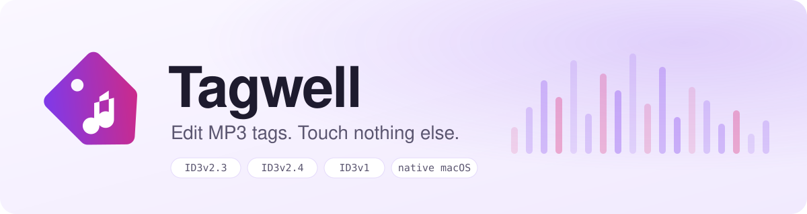
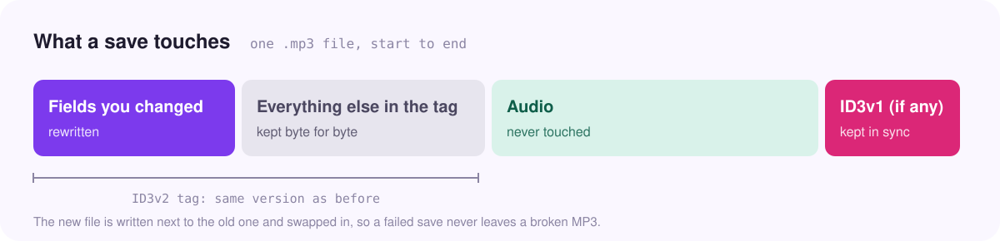

<div align="center">

<picture>
  <source media="(prefers-color-scheme: dark)" srcset="assets/banner-dark.svg">
  
</picture>

<br>

<a href="https://github.com/SherinBloemendaal/tagwell/actions/workflows/ci.yml"></a>
<a href="https://github.com/SherinBloemendaal/tagwell/releases/latest"></a>
<a href="LICENSE"></a>


**Tagwell** is a small, native macOS app for editing MP3 tags: one file at a time, or hundreds at once.<br>
Repo: [github.com/SherinBloemendaal/tagwell](https://github.com/SherinBloemendaal/tagwell)

[Install](#-install) · [Highlights](#-highlights) · [How it works](#-how-it-works) · [Organising a big library](#-organising-a-big-library) · [Shortcuts](#%EF%B8%8F-shortcuts) · [Roadmap](#%EF%B8%8F-roadmap) · [Building](#-building)

</div>

<br>

## ✨ Highlights

- **Only what you changed is written.** Every other part of the tag stays exactly as it was, including data Tagwell does not show: MusicBrainz IDs, iTunes data, lyrics, ratings.
- **The audio is never touched**, and the tag keeps its version (ID3v2.3 stays v2.3, ID3v2.4 stays v2.4).
- **Bulk edit.** Select several files and set artist, album, genre, year or cover art on all of them. Fields that differ show *Mixed*. Number tracks or turn file names into titles in one click.
- **Artist folders.** Every artist gets a folder in the sidebar. Drag files onto a folder to set their artist; drop them on *No Artist* to clear it.
- **Remembers your artists.** Saved artists come back as suggestions in the Artist field, so *Armin van Buuren* is spelled the same way on every file.
- **Search** by title, artist, album or file name.
- **YouTube thumbnails as cover art.** Paste a link, or let Tagwell find the video in the file name (`Title [ID].mp3`, as yt-dlp names downloads) or in a link in the comment. Thumbnails are cropped to a square by default; in bulk, every file gets its own video's thumbnail.
- **Rename files when saving**, optionally: to `Artist - Title`, or to a name you type. Characters macOS does not allow are replaced, and an existing file is never overwritten.
- **Safe saves.** The new file is written next to the old one and swapped in. Damaged tags and the old ID3v2.2 format are refused, not overwritten.

## 📦 Install

```bash
curl -fsSL https://sherin.dev/tagwell/install.sh | bash
```

Pin a release with `bash -s`:

```bash
curl -fsSL https://sherin.dev/tagwell/install.sh | bash -s v1.0.0
```

The script downloads `Tagwell.zip` from the GitHub release, checks it against `SHA256SUMS`, and installs `Tagwell.app` into `/Applications` (or `~/Applications` when `/Applications` is not writable; override with `TAGWELL_INSTALL`). Run it again to upgrade in place. To uninstall, move `Tagwell.app` to the Trash.

### Download

Download [`Tagwell.dmg`](https://github.com/SherinBloemendaal/tagwell/releases/latest/download/Tagwell.dmg), open it, and drag Tagwell onto the Applications folder. It runs on Apple Silicon and Intel Macs with macOS 15 or later.

<details>
<summary><b>Other downloads and the first launch</b></summary>

<br>

Every [release](https://github.com/SherinBloemendaal/tagwell/releases/latest) also has `Tagwell.zip` (the app on its own) and `SHA256SUMS`, which covers both downloads.

> [!NOTE]
> Tagwell is not notarized by Apple, so macOS blocks it the first time when it was downloaded with a browser. Open it once, then go to **System Settings → Privacy & Security** and click **Open Anyway**. Or clear the download flag:
>
> ```bash
> xattr -dr com.apple.quarantine /Applications/Tagwell.app
> ```
>
> The install script does not need this: files downloaded with `curl` are not flagged.

</details>

## 🧭 How it works

<picture>
  <source media="(prefers-color-scheme: dark)" srcset="assets/how-it-works-dark.svg">
  
</picture>

When you save, Tagwell reads the file again, replaces only the frames of the fields you changed, and copies everything else as it was. An old ID3v1 tag at the end of the file is updated as well, so the two never disagree.

Invalid input is caught before anything is written: a full date in an ID3v2.3 file (which only stores a year), or a track number that is not a number.

## 🎧 Organising a big library

Tagwell works well for a large collection of live sets, mixes or recordings that you want to tidy up before importing them into Spotify, Apple Music or a DJ app. Those apps mostly show **title**, **artist**, **album**, **track number** and **cover art**, so those are the fields to get right.

1. **Open the whole folder** with ⌘O or by dropping it on the window. All MP3 files inside, including subfolders, are added and selected.
2. **Sort by artist.** Select the sets of one artist and drag them onto their folder in the sidebar. Use **Add Artist** to create a folder first. *No Artist* shows what is left.
3. **Fill in the rest together.** Select the sets of one event and type the album once, for example `Tomorrowland 2024`, and drop the event's artwork on the cover box.
4. **Cover art from YouTube.** Downloaded the sets from YouTube? *YouTube Thumbnails* gives every selected file its own video's thumbnail, using the video ID in the file name or comment.
5. **Number and name.** *Number Tracks* gives them `1/12`, `2/12`… in list order; *Use File Names* copies the file names into the titles. Turn on *Rename the files to Artist - Title* to tidy the file names as well.
6. **Save All** with ⌥⌘S.

> [!TIP]
> Pick one pattern and stick to it, for example *Artist* = the DJ, *Album* = `Event Year`, *Title* = `Live at Event Year (Stage)`. Streaming apps group by album and artist, so a steady pattern keeps every set of one event together.

## ⌨️ Shortcuts

| Action                         | Shortcut |
| ------------------------------ | -------- |
| Open files or folders          | ⌘O       |
| Save the selected files        | ⌘S       |
| Save all edited files          | ⌥⌘S      |
| Select all files in the list   | ⌘A       |

Every toolbar button has a tooltip; hover over it to see what it does. An orange dot in the list marks files with unsaved changes, and Tagwell asks before quitting if there are any.

## 🗺️ Roadmap

Ideas for later. Nothing here is promised.

- **Download from YouTube with [yt-dlp](https://github.com/yt-dlp/yt-dlp).** Paste a link, and Tagwell downloads the audio as MP3 through yt-dlp, fills in the title, artist and cover art from the video, and adds it to the list. yt-dlp would be an optional install, used only when present.

## 🔨 Building

Requires macOS 15 or later and Xcode 26 (Swift 6.2 or later). There are no dependencies.

```bash
./build-app.sh          # build/Tagwell.app for this Mac
UNIVERSAL=1 ./build-app.sh   # Apple Silicon and Intel in one app
scripts/make-dmg.sh     # build/Tagwell.dmg from build/Tagwell.app
swift test              # run the tests
```

Releases are built by GitHub Actions: push a tag like `v1.2.0` and the [Release workflow](.github/workflows/release.yml) tests, builds a universal `Tagwell.app`, and publishes `Tagwell.dmg` and `Tagwell.zip` with `SHA256SUMS`.

<details>
<summary><b>Project layout</b></summary>

<br>

| Path                   | What it holds                                                              |
| ---------------------- | -------------------------------------------------------------------------- |
| `Sources/ID3Kit`       | Reading and writing ID3v2.3, ID3v2.4 and ID3v1 tags. No AppKit.            |
| `Sources/Tagwell`      | The SwiftUI app: artist folders, file list, single and bulk editors.       |
| `Tests/ID3KitTests`    | Tests for the tag code: round trips, kept frames, encodings, validation.   |
| `Tests/TagwellTests`   | Tests for the app: folders, search, artist memory, bulk tools, renaming, YouTube links. |
| `install.sh`           | The install script.                                                        |
| `art/`                 | The app icon and the DMG background, as SVG.                               |
| `scripts/make-art.sh`  | Turns `art/` into `Resources/AppIcon.icns` and the DMG background.         |
| `scripts/make-dmg.sh`  | Builds `Tagwell.dmg` with [dmgbuild](https://github.com/dmgbuild/dmgbuild). |

</details>

## 📄 License

MIT. See [LICENSE](LICENSE).
